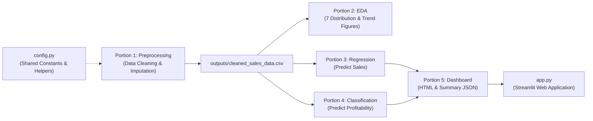

# Retail Sales & Profitability Intelligence 📊

[](https://www.python.org/)
[](https://scikit-learn.org/)
[](https://streamlit.io/)
[](https://NishuBhandari.github.io/Retail-Sales-Profitability-Intelligence/)
[](https://opensource.org/licenses/MIT)

An end-to-end Machine Learning and Business Intelligence solution that analyzes enterprise transaction data to predict continuous **Sales revenue** and classify **Order Profitability** before order fulfillment.

---

## 🚀 Live Demos

- 🌐 **Interactive Executive Dashboard (GitHub Pages):** [View Live Dashboard](https://NishuBhandari.github.io/Retail-Sales-Profitability-Intelligence/)
- ⚡ **Interactive Streamlit Web App:** Run locally via `streamlit run app.py` or deploy via [Streamlit Community Cloud](https://share.streamlit.io).

---

## 📈 Executive Performance & KPI Summary

| Metric | Value | Description |
| :--- | :--- | :--- |
| **Total Gross Revenue** | **$1,282,169.63** | Cumulative sales volume across all recorded transactions |
| **Total Net Profit** | **$129,292.97** | Net business profit generated |
| **Net Profit Margin** | **10.08%** | Portfolio-wide return on sales |
| **Total Quantity Sold** | **17,476 units** | Total order units fulfilled |
| **Profitable Order Rate** | **50.90%** (341 / 670) | Nearly balanced binary split between profitable and loss-making orders |

---

## 🤖 Machine Learning Benchmarks

### 1. Regression (Predict Continuous Sales)
Target: `Sales ($)`. Features: `Order Quantity`, `Unit Price`, `Shipping Cost`, `Order Month`, `Order Year`, `Order Priority`, `Ship Mode`, `Customer Segment`, `Product Category`.

| Model Architecture | Test $R^2$ | Test RMSE | Test MAE | Highlights |
| :--- | :---: | :---: | :---: | :--- |
| **Linear Regression** (Baseline) | 0.5903 | $2,024.91 | $1,330.44 | Misses multiplicative interaction effects |
| **Decision Tree Regressor** | 0.6632 | $1,836.03 | $592.54 | Strong training fit, test variance |
| **Random Forest Regressor** | **0.7826** | **$1,475.05** | **$389.81** | Lowest mean absolute error ($389) |
| **Polynomial Regression (Deg 2)** 🏆 | **0.8092** | **$1,381.66** | **$645.93** | **Best overall $R^2$**: Captures $\text{Quantity} \times \text{Price}$ dynamics |

---

### 2. Classification (Predict Order Profitability)
Target: `is_profitable` ($1$ for Profit $> 0$, $0$ for Loss / Break-even).

| Model Architecture | Test Accuracy | Test $F_1$-Score | Precision | Recall | Primary Finding |
| :--- | :---: | :---: | :---: | :---: | :--- |
| **Logistic Regression** (Baseline) | 67.91% | 0.7075 | 65.82% | 76.47% | Good baseline linear decision boundary |
| **Decision Tree Classifier** | 69.40% | 0.7211 | 67.09% | 77.94% | Interpretable rule-based decision trees |
| **Random Forest Classifier** 🏆 | **78.36%** | **0.7972** | **76.00%** | **83.82%** | **Best Classifier**: High recall identifies profitable orders accurately |

---

## 🏗️ 5-Portion Modular Architecture



- [`config.py`](config.py): Shared paths, directories, and Scikit-Learn preprocessors.
- [`portion1_preprocessing.py`](portion1_preprocessing.py): Data cleaning, handling missing values, temporal and target feature engineering.
- [`portion2_eda.py`](portion2_eda.py): Generates 7 analytical and distribution figures.
- [`portion3_regression.py`](portion3_regression.py): Fits and evaluates 4 continuous Sales regressors.
- [`portion4_classification.py`](portion4_classification.py): Trains and benchmarks 3 binary profitability classifiers.
- [`portion5_dashboard.py`](portion5_dashboard.py): Compiles the interactive executive HTML dashboard and summary JSON.
- [`app.py`](app.py): Full-featured Streamlit interactive web application with a live "What-If" simulator.

---

## ⚡ Quickstart & Local Execution

### 1. Clone & Install Dependencies
```bash
git clone https://github.com/NishuBhandari/Retail-Sales-Profitability-Intelligence.git
cd Retail-Sales-Profitability-Intelligence
pip install -r requirements.txt
```

### 2. Run the Machine Learning Pipeline
```bash
python main.py
# or run the legacy entry point:
python retail_sales_profitability.py
```

### 3. Launch the Interactive Web Application
```bash
streamlit run app.py
```

---

## 🌐 Deploying to GitHub & GitHub Pages

1. **Push your code to GitHub**:
   ```bash
   git init
   git add .
   git commit -m "feat: Initial commit for Retail Sales Intelligence"
   git branch -M main
   git remote add origin git@github.com:NishuBhandari/Retail-Sales-Profitability-Intelligence.git
   git push -u origin main
   ```

2. **Enable GitHub Pages (Live in 30 Seconds)**:
   - Go to your repository on GitHub: `https://github.com/NishuBhandari/Retail-Sales-Profitability-Intelligence`.
   - Click **Settings** ➔ **Pages** (on the left menu).
   - Under **Build and deployment** ➔ **Source**, choose **Deploy from a branch**.
   - Select **Branch: `main`** and folder **`/ (root)`**, then click **Save**.
   - Your dashboard will be live at: `https://NishuBhandari.github.io/Retail-Sales-Profitability-Intelligence/`.

---

## 📜 License
This project is licensed under the [MIT License](LICENSE).
